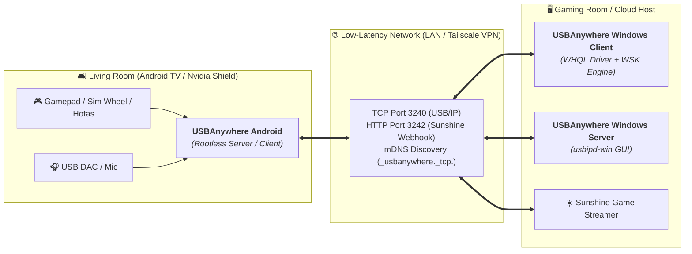

# 🌐 USBAnywhere Android — The Free, Open-Source VirtualHere Alternative for Android & Android TV

🌐 **Language / Idioma:** **English** | [Español](README_ES.md)

**v1.0.1** | **Part of the [USBAnywhere Ecosystem](https://github.com/oscarlosu-lab/USBAnywhere)**  
[🌍 Official Website](https://oscarlosu-lab.github.io/USBAnywhere/) | [📦 Releases & APK](https://github.com/oscarlosu-lab/USBAnywhere-Android/releases/latest) | [🔗 USBAnywhere Windows Client](https://github.com/oscarlosu-lab/USBAnywhere) | [🖥️ USBAnywhere Windows Server](https://github.com/oscarlosu-lab/USBAnywhere-Server) | [💬 Reddit Community](https://www.reddit.com/r/UsbAnywhere/) | [☀️ Sunshine & Moonlight Setup](docs/SUNSHINE_MOONLIGHT_INTEGRATION_EN.md) | [📖 Strategic Roadmap](ROADMAP.md) | [🔄 Engineering Workflow](WORKFLOW.md)

[](https://oscarlosu-lab.github.io/USBAnywhere/)
[](https://www.reddit.com/r/UsbAnywhere/)
[](https://ko-fi.com/oscarlosu)
[-green.svg)](https://developer.android.com)
[](https://developer.android.com/tv)
[](https://developer.android.com/jetpack/compose)
[-orange.svg)](https://docs.kernel.org/usb/usbip_protocol.html)
[](LICENSE)
[]()
[-success.svg)]()

> **Why pay $49.00 per server and be restricted to a single USB device?**  
> **USBAnywhere Android** is the definitive open-source USB-over-IP engine for Android phones, tablets, and **Android TV / Google TV (Nvidia Shield)**. It seamlessly integrates into the **USBAnywhere Suite**, enabling zero-cost, multi-device USB tunneling between your living room TV and remote gaming PCs running Sunshine/Moonlight or the USBAnywhere Windows Client.

---

## ⚔️ Why Choose USBAnywhere Over VirtualHere?

| Feature | **USBAnywhere Android** | **VirtualHere Android** |
| :--- | :---: | :---: |
| **Pricing & License** | **100% Free & Open Source (GPLv3)** | 💰 $49.00 USD per server (locked to hardware) |
| **Simultaneous USB Devices** | **♾️ Unlimited** | ⚠️ 1 Device Only in trial |
| **Root Requirement** | 🛡️ **Zero Root Required** (OTG user-space mediation) | ⚠️ Generic Android driver |
| **Sunshine & Moonlight Integration**| ⚡ **Built-in Webhook (Port 3242) + Auto-Handoff** | ❌ Manual batch scripts and disconnect pain |
| **Gamepad Quick-Toggle** | 🎮 **`Guide + Select` (2.5s)** switch TV/PC | ❌ None |
| **DualSense & Sim Racing** | 🏎️ **Dedicated Haptics Buffer & FFB Jitter-Guard** | ⚠️ Packet drop & wheel shudder over Wi-Fi |
| **Android TV / Shield 10-Foot UI** | 📺 **Native D-Pad Focus & Leanback Banner** | 🕰️ Basic Android interface |
| **WAN & Remote Connectivity** | 🔒 **Tailscale, WireGuard & Cyber QR Token** | ❌ Manual port forwarding |
| **Package Size** | 🚀 **2.07 MB APK** (Includes 20.5K device database) | ~6 MB |

---

## 🌐 The USBAnywhere Triad: Multi-Platform Synergy



1. **Android as Living Room USB Server**: Plug racing wheels (Logitech G29, Fanatec), flight sticks, or DualSense gamepads into your Nvidia Shield or Android TV box. Stream your game with Sunshine/Moonlight while the [USBAnywhere Windows Client](https://github.com/oscarlosu-lab/USBAnywhere) receives raw USB packets with full force feedback and adaptive triggers.
2. **Android as Client for Remote Peripherals**: Access 3D printers (OctoPrint), CNCs, SDR dongles, or office scanners connected to a Windows host running [USBAnywhere Windows Server](https://github.com/oscarlosu-lab/USBAnywhere-Server).
3. **Sunshine Auto-Handoff**: Sunshine triggers `POST /api/stream/start` on launch and `POST /api/stream/stop` on exit, automatically toggling controller ownership without manual intervention.

### 🔗 USBAnywhere Ecosystem Components

| Component | Platform / Role | Description |
|---|---|---|
| **[USBAnywhere Client](https://github.com/oscarlosu-lab/USBAnywhere)** | 🖥️ Windows 10/11 (x64 / ARM64) | Connect to remote USB devices with WHQL drivers & WSK engine |
| **[USBAnywhere Server](https://github.com/oscarlosu-lab/USBAnywhere-Server)** | 🌐 Windows 10/11 (.NET 9.0) | Share local USB peripherals over network with GUI & Auto-Bind |
| **[USBAnywhere Android](https://github.com/oscarlosu-lab/USBAnywhere-Android)** | 📱 Android & Android TV | Rootless USB/IP server, Sunshine handoff & DualSense haptics |
| **[Official Website](https://oscarlosu-lab.github.io/USBAnywhere/)** | 🌍 Web Portal | Interactive guides, documentation & download hub |
| **[Reddit Community](https://www.reddit.com/r/UsbAnywhere/)** | 💬 r/UsbAnywhere | Support, discussions, community setups & announcements |
| **[Support on Ko-fi](https://ko-fi.com/oscarlosu)** | ☕ Community | Support hosting, driver testing & open-source engineering |
| **[Downloads & Mirrors](https://github.com/oscarlosu-lab/USBAnywhere-Downloads)** | 📦 Backup Archive | Centralized distribution mirror and checksum verification |

---

## ⚡ Key Highlights

### 🔌 Rootless USB/IP Server (Port 3240)
- **Zero Root Required**: Operates completely in user-space using `android.hardware.usb.UsbManager` (`UsbDeviceConnection`, `controlTransfer`, `bulkTransfer`).
- Share gamepads, flight sticks, racing wheels, 3D printers, CNCs, and webcams connected via USB-OTG or USB-C hubs.
- High-Performance Foreground Service with `WakeLock` and `WifiLock` preventing Android OS power throttling.

### 🎮 Gaming Synergy & Esports Polling Engine

### 📱 Background Execution & Mobile Gaming
- **Full Foreground Service Persistence**:
  - Operates as a resilient Android Foreground Service (`UsbIpServerService`) typed with `android:foregroundServiceType="connectedDevice"`.
  - Holds an active `PARTIAL_WAKE_LOCK` and `WIFI_MODE_FULL_HIGH_PERF` lock, ensuring the Android kernel never throttles network traffic or kills the USB mediation daemon when running mobile games, emulators, or switching apps.
  - Informative persistent status notification in the Android notification shade with real-time client connection metrics.

### 🎮 Live Esports Gamepad HUD & Simulator
- **Sunshine Auto-Handoff & Quick-Toggle**:
  - Embedded HTTP micro-server (Port 3242) for Sunshine `do` and `undo` commands.
  - Gamepad combo (`Guide + Select` held for 2.5s) toggles control between Android TV navigation and PC USB/IP streaming.
- **Sony DualSense Engine**:
  - Circular isochronous audio buffer delivering pristine haptics and adaptive triggers over Wi-Fi without audio underflows.
- **Sim Racing & HOTAS FFB Jitter-Guard**:
  - Monotonic sequence ordering and stale packet dropper eliminating violent wheel shakes from delayed Wi-Fi packets.
- **Multiplayer Hub Slot Locks**:
  - Deterministic P1-P4 player binding tied to USB port topology so controllers never scramble player numbers.
- **Live Esports Gamepad HUD**:
  - Real-time frequency tracker in **Hz**, min/max bounds, jitter ($\sigma$ in ms), analog stick crosshairs, and 1000/8000 Hz synthetic simulator.

### 🔒 WAN Zero-Trust Security & Audio Bridge
- **Tailscale & WireGuard Native Discovery**:
  - Automatically identifies CGNAT (`100.64.0.0/10`) and VPN interfaces.
  - Generates compact pairing tokens (`UA1:...`) and renders dynamic Cyber QR codes natively on Compose Canvas without heavy third-party libraries.
- **Friction-Free WAN Mesh & TLS 1.3**:
  - Direct RFC-compliant USB/IP protocol negotiation over encrypted VPN tunnels (Tailscale/WireGuard) with zero PIN friction.
- **UAC2 Audio & Headset Microphone Bridge**:
  - 48 kHz / 16-bit PCM stereo bridge with user-selectable buffer profiles: **2ms** (Esports local), **4ms** (Wi-Fi), **8ms** (WAN).

### 📺 10-Foot UI for Android TV & Google TV
- Official Leanback launcher integration with custom high-contrast cyber banner (`tv_banner.xml`).
- Declares `android.hardware.touchscreen=false` for full Android TV Play Store compliance.
- D-Pad remote control focus indicators with glowing `NeonCyan` borders.

### 🗄️ Embedded 20.5K Device Database
- Offline SQLite catalog with 3,427 vendors and 20,551 products indexed from official USB-IF databases.
- Semantic classification: 🎮 Gamepad, 🏎️ Racing Wheel, 🖱️ Mouse, ⌨️ Keyboard, 📷 Camera, 🖨️ 3D Printer, 🎧 Audio, 💾 Storage, 🔌 Generic.

### 🛡️ Non-Intrusive Opt-In Architecture
- `BootCompletedReceiver` and `UsbAttachedReceiver` are `android:enabled="false"` by default in the Manifest.
- Dynamic `PackageManager.setComponentEnabledSetting` ensures zero background battery drain or unwanted OS dialogs until explicitly enabled in Settings.

---

---

## 📱 Navigation & App Architecture

The user interface is built on **Jetpack Compose Material 3** with native 10-foot D-Pad remote control focus indicators for Android TV / Google TV:

| Tab | Icon | Purpose |
|---|:---:|---|
| **Server** | 🔌 | One-tap rootless USB/IP server start/stop, real-time USB-OTG peripheral discovery, and connection status hero card. |
| **Client** | 💻 | Auto-discovery of remote USB/IP servers via mDNS & UDP 3241, manual host IP connection, and connection guide. |
| **Gamepad** | 🎮 | Live polling rate monitor in Hz, jitter ($\sigma$ in ms), 1000/8000 Hz simulator, Sunshine auto-handoff, and multiplayer slot locks. |
| **Settings** | ⚙️ | Esports low-latency tuning (`TCP_NODELAY`, ring buffers), opt-in auto-start on boot/USB, TV kiosk mode, and port configuration (:3240, :3242). |

## 📁 Source Tree Structure

```text
app/src/main/
├── AndroidManifest.xml                  # Leanback, Non-Touch, USB Host, Foreground Service
├── assets/
│   └── usb_catalog.db                   # SQLite database (3,427 vendors, 20,551 products)
├── java/com/usbanywhere/
│   ├── MainActivity.kt                  # Edge-to-edge Compose host & D-Pad key dispatcher
│   ├── audio/                           # UAC2 Audio Bridge & Jitter Buffering
│   ├── catalog/                         # Semantic Hardware Classification Engine (SQLite)
│   ├── client/                          # USB/IP Client Implementation (mDNS, UDP, Roaming)
│   ├── data/                            # Persistent AppPreferences & UsbModels
│   ├── gamepad/                         # Gamepad Testing & Polling Rate Engine
│   ├── gaming/sunshine/                 # Sunshine Webhook (Port 3242) & Handoff Manager
│   ├── network/wan/                     # Tailscale/WireGuard WAN & Cyber QR Matrix
│   ├── protocol/                        # Standard Binary USB/IP Wire Protocol (RFC Draft)
│   ├── receiver/                        # Non-Intrusive Boot & USB Attached Receivers
│   ├── security/                        # TLS 1.3 Socket Factory & Encryption Helpers
│   ├── server/                          # Rootless USB/IP Server Daemon (Port 3240)
│   └── ui/                              # Jetpack Compose Material 3 (Cyber Neon Theme)
└── res/drawable/
    └── tv_banner.xml                    # Android TV 320x180 dp Leanback home banner
```

---

## 🛠️ Building & Verification

### Prerequisites
- **JDK**: JDK 17+ or JDK 21 (Microsoft Hotspot)
- **Android SDK**: Build Tools 35.0.0+, Platform API 35/36
- **Gradle**: 8.9+ (Wrapper included)

### Compilation Commands
```powershell
# 1. Run unit test suite (38 tests)
.\gradlew.bat test

# 2. Build Minified Signed Production APK (2.07 MB)
.\gradlew.bat assembleRelease

# 3. Build Google Play Store App Bundle (4.26 MB)
.\gradlew.bat bundleRelease
```

### Automated Testing & Quality Gate
```powershell
# Execute the full unit test suite (38 tests)
.\gradlew.bat test
```

---

## 🔒 Security & Contribution Policy

This repository adheres to strict Zero-Trust engineering and security practices. Contributions, security audits, and issue reports are welcomed via standard GitHub Pull Requests and Issues.

---

## 📄 License

This project is licensed under the **GNU General Public License v3.0 (GPLv3)**.

> **USBAnywhere Android is 100% Free and Open Source.** You are free to run, study, share, and modify the software under the terms of the GNU General Public License as published by the Free Software Foundation.

See [LICENSE](LICENSE) for full legal terms and conditions.
