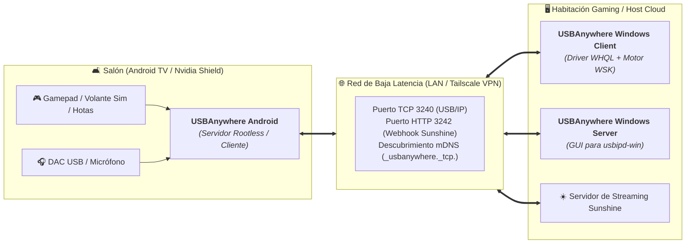

# 🌐 USBAnywhere Android — La Alternativa Libre y Gratuita a VirtualHere para Android y Android TV

🌐 **Idioma / Language:** [English](README.md) | **Español**

**v1.0.1** | **Parte del [Ecosistema USBAnywhere](https://github.com/oscarlosu-lab/USBAnywhere)**  
[🌍 Web Oficial](https://oscarlosu-lab.github.io/USBAnywhere/) | [📦 Releases y APK](https://github.com/oscarlosu-lab/USBAnywhere-Android/releases/latest) | [🔗 USBAnywhere Cliente Windows](https://github.com/oscarlosu-lab/USBAnywhere) | [🖥️ USBAnywhere Servidor Windows](https://github.com/oscarlosu-lab/USBAnywhere-Server) | [💬 Comunidad Reddit](https://www.reddit.com/r/UsbAnywhere/) | [☀️ Guía Sunshine & Moonlight](docs/SUNSHINE_MOONLIGHT_INTEGRATION_ES.md) | [📖 Roadmap Estratégico](ROADMAP.md) | [🔄 Workflow de Ingeniería](WORKFLOW.md)

[](https://oscarlosu-lab.github.io/USBAnywhere/)
[](https://www.reddit.com/r/UsbAnywhere/)
[](https://ko-fi.com/oscarlosu)
[-green.svg)](https://developer.android.com)
[](https://developer.android.com/tv)
[](https://developer.android.com/jetpack/compose)
[-orange.svg)](https://docs.kernel.org/usb/usbip_protocol.html)
[](LICENSE)
[]()
[-success.svg)]()

> **¿Por qué pagar 49,00 $ por servidor y estar limitado a un único dispositivo USB?**  
> **USBAnywhere Android** es el motor USB-over-IP libre y definitivo para móviles, tablets y **Android TV / Google TV (Nvidia Shield)**. Se integra de forma nativa en la **Suite USBAnywhere**, permitiendo tunelizar periféricos USB sin coste alguno entre tu salón y PCs gaming remotos con Sunshine/Moonlight o el cliente Windows de USBAnywhere.

---

## ⚔️ ¿Por qué elegir USBAnywhere frente a VirtualHere?

| Característica | **USBAnywhere Android** | **VirtualHere Android** |
| :--- | :---: | :---: |
| **Precio y Licencia** | **100% Gratis y Código Abierto (GPLv3)** | 💰 49,00 USD / servidor (atado al hardware) |
| **Dispositivos Simultáneos** | **♾️ Ilimitados** | ⚠️ Solo 1 dispositivo en versión de prueba |
| **Requisito de Root** | 🛡️ **Cero Root Requerido** (mediación en espacio de usuario OTG) | ⚠️ Driver genérico |
| **Integración con Sunshine & Moonlight** | ⚡ **Webhook integrado (Puerto 3242) + Auto-Handoff** | ❌ Scripts batch complejos y desconexiones |
| **Conmutador Rápido de Mando** | 🎮 **`Guide + Select` (2.5s)** alterna TV / PC | ❌ Inexistente |
| **DualSense & Sim Racing** | 🏎️ **Búfer de hápticos dedicado & FFB Jitter-Guard** | ⚠️ Caídas de paquetes y temblores de volante |
| **Interfaz 10-Foot para Android TV** | 📺 **Foco D-Pad interactivo & Banner Leanback** | 🕰️ Interfaz clásica de teléfono |
| **Seguridad WAN & Privacidad** | 🔒 **Tailscale, WireGuard & Código QR Cyber** | ❌ Reenvío de puertos manual sin cifrar |
| **Tamaño del Paquete** | 🚀 **APK de 2.07 MB** (Incluye catálogo de 20.5K dispositivos) | ~6 MB |

---

## 🌐 La Tríada USBAnywhere: Sinergia Multiplataforma



1. **Android como Servidor USB de Salón**: Conecta volantes de carreras (Logitech G29, Fanatec, Thrustmaster), joysticks HOTAS o mandos DualSense a tu Nvidia Shield o Android TV box. Transmite el juego con Sunshine/Moonlight mientras el [Cliente Windows de USBAnywhere](https://github.com/oscarlosu-lab/USBAnywhere) recibe los paquetes USB nativos con force feedback completo y gatillos adaptativos.
2. **Android como Cliente para Periféricos Remotos**: Accede a impresoras 3D (OctoPrint), máquinas CNC, receptores SDR o escáneres conectados a un PC con [Servidor Windows USBAnywhere](https://github.com/oscarlosu-lab/USBAnywhere-Server) o a una Raspberry Pi con Linux.
3. **Sinergia con Sunshine**: Sunshine dispara `POST /api/stream/start` al iniciar la partida y `POST /api/stream/stop` al cerrar el juego, transfiriendo el control del gamepad entre la tele y el PC de forma 100% transparente.

### 🔗 Componentes del Ecosistema USBAnywhere

| Componente | Plataforma / Rol | Descripción |
|---|---|---|
| **[USBAnywhere Cliente](https://github.com/oscarlosu-lab/USBAnywhere)** | 🖥️ Windows 10/11 (x64 / ARM64) | Conecta dispositivos USB remotos con drivers WHQL y motor WSK |
| **[USBAnywhere Servidor](https://github.com/oscarlosu-lab/USBAnywhere-Server)** | 🌐 Windows 10/11 (.NET 9.0) | Comparte periféricos USB locales por red con GUI y Auto-Bind |
| **[USBAnywhere Android](https://github.com/oscarlosu-lab/USBAnywhere-Android)** | 📱 Android y Android TV | Servidor USB/IP rootless, integración Sunshine y hápticos DualSense |
| **[Web Oficial](https://oscarlosu-lab.github.io/USBAnywhere/)** | 🌍 Portal Web | Guías interactivas, documentación y centro de descargas |
| **[Comunidad Reddit](https://www.reddit.com/r/UsbAnywhere/)** | 💬 r/UsbAnywhere | Soporte, debates, configuraciones de la comunidad y anuncios |
| **[Apoyar en Ko-fi](https://ko-fi.com/oscarlosu)** | ☕ Comunidad | Apoya el hosting, pruebas de hardware y desarrollo libre |
| **[Descargas y Mirrors](https://github.com/oscarlosu-lab/USBAnywhere-Downloads)** | 📦 Archivo Backup | Mirror de distribución centralizado y verificación de checksums |

---

## ⚡ Capacidades Principales

### 🔌 Servidor USB/IP Rootless (Puerto 3240)
- **Cero Root Requerido**: Funciona en espacio de usuario con `android.hardware.usb.UsbManager` (`UsbDeviceConnection`, `controlTransfer`, `bulkTransfer`).
- Comparte mandos, volantes, impresoras 3D y webcams conectadas por USB-OTG o hubs USB-C.
- Servicio en primer plano con `WakeLock` y `WifiLock` de alto rendimiento para evitar reposo por ahorro de batería.

### 🎮 Sinergia Gaming y Motor de Sondeo Esports

### 📱 Ejecución en Segundo Plano y Juegos Móviles
- **Persistencia mediante Foreground Service**:
  - Se ejecuta como un servicio en primer plano persistente (`UsbIpServerService`) con `android:foregroundServiceType="connectedDevice"`.
  - Mantiene un `WakeLock` de CPU y un `WifiLock` de alto rendimiento (`WIFI_MODE_FULL_HIGH_PERF`), garantizando que Android nunca mate el servidor ni reduzca las frecuencias mientras juegas en el móvil o alternas entre aplicaciones.
  - Notificación informativa permanente en la barra de estado con métricas de conexión en tiempo real.

### 🎮 HUD Visual Esports y Simulador
- **Auto-Handoff Sunshine & Atajo de Mando**:
  - Microservidor HTTP integrado (Puerto 3242) para comandos `do` y `undo` de Sunshine.
  - Atajo de mando (`Guide + Select` durante 2.5s) para alternar el control entre Android TV y el PC remoto.
- **Motor Sony DualSense**:
  - Búfer de audio isócrono circular que previene micro-cortes y artefactos en vibración háptica y gatillos adaptativos sobre Wi-Fi.
- **Jitter-Guard para Sim Racing y HOTAS**:
  - Ordenación monotónica de secuencias y descarte de paquetes obsoletos para evitar sacudidas bruscas de Force Feedback (FFB).
- **Asignación Fija de Slots Multijugador (P1-P4)**:
  - Reserva fija de ranuras ligada a la topología física del puerto USB; los mandos no intercambian número de jugador al suspenderse.
- **HUD Visual Esports**:
  - Frecuencímetro en vivo en **Hz**, límites mín/máx, jitter ($\sigma$ en ms), punto de mira analógico y simulador sintético a 1000/8000 Hz.

### 🔒 Seguridad WAN Zero-Trust & Puente de Audio
- **Detección Nativa de Tailscale y WireGuard**:
  - Detección automática de rangos CGNAT (`100.64.0.0/10`) y adaptadores VPN.
  - Generador de tokens compactos (`UA1:...`) y renderizador de códigos QR Cyber 25x25 directamente en Jetpack Compose sin librerías externas.
- **Conexión Directa WAN Mesh & TLS 1.3**:
  - Negociación USB/IP estándar compatible con el borrador RFC sobre túneles seguros (Tailscale/WireGuard) sin fricción de PIN.
- **Puente de Audio USB UAC2 & Micrófono**:
  - Puente estéreo PCM a 48 kHz / 16 bits con latencia seleccionable: **2ms** (Esports en LAN), **4ms** (Wi-Fi), **8ms** (Internet WAN).

### 📺 Interfaz 10-Foot para Android TV y Google TV
- Banner Leanback oficial de alto contraste (`tv_banner.xml`).
- Declaración de pantalla no táctil (`android.hardware.touchscreen=false`) cumpliendo normativas de Google Play para TV.
- Navegación D-Pad con mando a distancia y resplandor `NeonCyan` en elementos enfocados.

### 🗄️ Base de Datos de 20,551 Dispositivos Integrada
- Catálogo SQLite offline con 3,427 fabricantes y 20,551 productos oficiales USB-IF.
- Clasificación semántica automática: 🎮 Gamepad, 🏎️ Volante, 🖱️ Ratón, ⌨️ Teclado, 📷 Cámara, 🖨️ Impresora 3D, 🎧 Audio, 💾 Almacenamiento, 🔌 Genérico.

### 🛡️ Política de No Intrusión (Opt-In Estricto)
- Receptores de arranque (`BootCompletedReceiver`) y conexión USB (`UsbAttachedReceiver`) desactivados por defecto en el Manifest (`android:enabled="false"`).
- Activación dinámica mediante `PackageManager.setComponentEnabledSetting` solo cuando el usuario lo habilita voluntariamente en Ajustes.

---

---

## 📱 Navegación y Arquitectura de la Aplicación

La interfaz de usuario está desarrollada íntegramente en **Jetpack Compose Material 3** con foco interactivo D-Pad de alto contraste para Android TV / Google TV:

| Pestaña | Icono | Propósito |
|---|:---:|---|
| **Servidor** | 🔌 | Control del servidor USB/IP rootless con un toque, detección OTG en tiempo real y tarjeta principal de estado. |
| **Cliente** | 💻 | Auto-descubrimiento de servidores USB/IP por mDNS y UDP 3241, conexión manual por IP y tarjeta de asistencia. |
| **Gamepad** | 🎮 | Monitor de sondeo en vivo (Hz, jitter, mín/máx), simulador a 1000/8000 Hz, alternancia Sunshine y slots multijugador fijos. |
| **Ajustes** | ⚙️ | Optimización de baja latencia (`TCP_NODELAY`, búfers circulares), arranque opcional en inicio/USB, modo kiosco y puertos (:3240, :3242). |

## 🛠️ Compilación y Pruebas

```powershell
# 1. Ejecutar las 38 pruebas unitarias
.\gradlew.bat test

# 2. Generar APK Release minificado y firmado (2.07 MB)
.\gradlew.bat assembleRelease

# 3. Generar Google Play App Bundle firmado (4.26 MB)
.\gradlew.bat bundleRelease
```

---

## 🔒 Política de Seguridad y Contribuciones

Este repositorio sigue las directivas estrictas de seguridad y calidad de código. Se admiten contribuciones, auditorías de seguridad y reportes de incidencias a través de Pull Requests e Issues en GitHub.

---

## 📄 Licencia

Este proyecto está bajo la licencia **GNU General Public License v3.0 (GPLv3)**.

> **USBAnywhere Android es 100% software libre y código abierto.** Eres libre de ejecutar, estudiar, compartir y modificar el software bajo los términos de la Licencia Pública General de GNU publicada por la Free Software Foundation.

Consulta el archivo [LICENSE](LICENSE) para ver el texto completo de la licencia.
