# 🗺️ USBAnywhere Android — Strategic Technical Roadmap

> **Target Version**: v1.0.1 Stable (Dual-Mode USB/IP Engine)  
> **Orientation**: Community-driven (incorporating insights from r/MoonlightStreaming, r/cloudygamer, r/simracing, and r/selfhosted)  
> **Status**: Live & Published (v1.0.1 on GitHub & Community Triad)

---

## 📌 Milestone Overview

```mermaid
flowchart TD
    P1["Phase 1: Core Dual Engine & TV<br><b>[COMPLETED ✓]</b>"] --> P2["Phase 2: Gaming Synergy & Low Latency<br><b>[COMPLETED ✓]</b>"]
    P2 --> P3["Phase 3: WAN & Zero-Trust Security<br><b>[COMPLETED ✓]</b>"]
    P3 --> P4["Phase 4: Distribution & Production Hardening<br><b>[COMPLETED ✓]</b>"]

    subgraph "Phase 1: Foundations (Completed ✓)"
        A1[Rootless USB/IP Server 3240]
        A2[Zero-Config mDNS + UDP Discovery]
        A3[20.5K Device Catalog & Classifier]
        A4[Esports Gamepad HUD 1000Hz]
        A5[Android TV Leanback & D-Pad UI]
    end

    subgraph "Phase 2: Community Needs (Completed ✓)"
        B1["Sunshine Auto-Handoff & Quick-Toggle<br><i>(Guide+Select 2.5s / HTTP Webhook 3242)</i>"]
        B2["DualSense Adaptive Triggers & Haptics<br><i>(Isochronous USB Audio Endpoint Buffer)</i>"]
        B3["Sim Racing Wheel FFB Jitter Guard<br><i>(Logitech/Fanatec/Thrustmaster Queue)</i>"]
        B4["Multiplayer Hub Slot Locks<br><i>(Deterministic P1-P4 Port Binding)</i>"]
    end

    subgraph "Phase 3: WAN & Hardened Networking (Completed ✓)"
        C1["Tailscale / WireGuard WAN Zero-Config<br><i>(CGNAT 100.64.0.0/10 & Cyber QR Token)</i>"]
        C2["Friction-Free Direct USB/IP & TLS 1.3<br><i>(RFC-Compliant Wire Protocol)</i>"]
        C3["UAC2 USB Audio & Headset Mic Bridge<br><i>(48kHz/16-bit PCM + 2ms/4ms/8ms Buffer)</i>"]
    end

    subgraph "Phase 4: Release & Production Hardening (Completed ✓)"
        D1["Non-Intrusive Boot & USB Auto-Start<br><i>(Opt-in via Dynamic Component State)</i>"]
        D2["Configurable Ports & UX Preferences<br><i>(Port 3240/3242 + Toasts & Haptic Toggles)</i>"]
        D3["Production Signing & R8 Shrinking<br><i>(2.07 MB APK / 4.26 MB AAB Bundle - 90% Shrink)</i>"]
        D4["Zero-Trust QA & 38 Unit Tests Green"]
    end
```

---

## 🟢 Phase 1: Core Dual Engine & Android TV (Completed ✓)

- [x] **Rootless USB/IP Server (Port 3240)**:
  - User-space OTG mediation with `android.hardware.usb.UsbManager`.
  - Foreground Service with `PARTIAL_WAKE_LOCK` and `WIFI_MODE_FULL_HIGH_PERF`.
  - Binary protocol handlers: `OP_REQ_DEVLIST (0x8005)`, `OP_REQ_IMPORT (0x8003)`, and URB submit/unlink frames.
- [x] **Zero-Config Client & Auto-Roaming**:
  - Dual-mode network discovery: mDNS / Bonjour (`_usbanywhere._tcp.`) and UDP broadcast responder.
  - Smart Wi-Fi roaming machine (`TunnelState`) with 5-stage exponential backoff and automatic session restore.
- [x] **Hardware Identification & Semantics**:
  - Embedded SQLite database with 20,551 products and 3,427 vendors.
  - 9 visual categories with reactive chip filtering and device badges.
- [x] **Esports Gamepad Tester**:
  - Live digital speedometer measuring frequency in **Hz**, min/max bounds, and jitter ($\sigma$ in ms).
  - Crosshair stick indicators, trigger progress bars, and sub-millisecond 1000 Hz / 8000 Hz synthetic simulator.
- [x] **Android TV / Google TV Support**:
  - Leanback launcher integration with high-contrast banner (`tv_banner.xml`).
  - Full 10-foot UI D-Pad focus indicators with `NeonCyan` borders.

---

## 🟢 Phase 2: Community Priorities & Gaming Synergy (Completed ✓)

*Driven by real-world pain points identified across r/MoonlightStreaming and r/ShieldAndroidTV.*

- [x] **2.1. Sunshine Auto-Handoff & Quick-Toggle**:
  - **Local HTTP Webhook Server (Port 3242)**: Micro-daemon accepting `POST /api/stream/start`, `POST /api/stream/stop`, `POST /api/toggle`, and `GET /api/status`. Seamlessly hooks into Sunshine's `do` and `undo` command preparations.
  - **Hardware Quick-Toggle**: Gamepad combination (`Guide + Select` / `Back + Start` held for 2.5s) instantly switching between **Local Android TV navigation** and **Remote PC USB/IP Streaming**.
  - **Reactive HUD & Android Toasts**: Live banner and toast notifications confirming mode transitions.
- [x] **2.2. Sony DualSense Enhanced Engine (Haptics & Triggers)**:
  - Hardware profiles detecting Sony DualSense (`054C:0CE6`), DualSense Edge (`054C:0DF2`), and DualShock 4.
  - `IsochronousJitterBuffer`: Circular buffer for USB Audio / Haptic rumble packets eliminating underflows and crackles over Wi-Fi.
- [x] **2.3. Sim Racing & HOTAS FFB Jitter-Guard**:
  - Monotonic sequence ordering and stale packet dropper for Force Feedback (FFB) Interrupt OUT frames.
  - Hardware profiles for Logitech (G29, G920, G923, G27), Thrustmaster (T300RS, T-GT, T150, T248), Fanatec, and Moza.
- [x] **2.4. Multiplayer USB Hub Manager (Deterministic P1-P4)**:
  - Fixed player slot assignment (P1 Blue, P2 Red, P3 Green, P4 Yellow) bound to hardware descriptors and USB port topology.
  - Permanent slot reservations: controllers never scramble player numbers when reconnecting after sleep or battery drop.
  - Visual 4-slot status bar in the Gamepad tab.

---

## 🟢 Phase 3: WAN, Zero-Trust Security & Audio (Completed ✓)

- [x] **3.1. Tailscale & WireGuard Native Discovery**:
  - `WanInterfaceDetector`: Active network scan identifying Tailscale CGNAT (`100.64.0.0/10`), WireGuard (`wg0`, `tun*`), and mesh VPN tunnels.
  - `WanPairingToken`: Compact URI serialization (`UA1:...` base64 token) packaging host IP, port, and server identity.
  - `CyberQrGenerator`: Zero-bloat deterministic QR 25x25 matrix renderer running natively on Compose Canvas without external dependencies (~3MB APK saving).
- [x] **3.2. Direct RFC-Compliant Wire Protocol & TLS 1.3**:
  - Clean standard USB/IP binary protocol negotiation (RFC draft) without proprietary PIN barriers for plug-and-play client compatibility.
  - Seamless handling of DEVLIST and IMPORT commands across standard Linux, Windows, and Android clients.
  - TlsSocketFactoryHelper: TLS 1.3 / 1.2 encrypted wrapper for raw TCP USB/IP communication over untrusted public WAN.
- [x] **3.3. UAC2 Virtual Audio & Microphone Bridge**:
  - `UsbAudioProfile` & `UsbAudioBridge`: USB Audio Class 1.0/2.0 detection and high-fidelity 48 kHz / 16-bit PCM stereo pipeline.
  - Ultra low-latency jitter buffering with user-selectable profiles: **2ms** (Esports local mesh), **4ms** (Standard Wi-Fi), and **8ms** (Public Internet WAN).

---

## 🟢 Phase 4: Distribution & Production Hardening (Completed ✓)

### 4.1. Non-Intrusive Auto-Launch & Android TV Kiosk Mode (Implemented & Verified ✓)
- **Zero-Intrusion Policy (Disabled by Default)**:
  - `RECEIVE_BOOT_COMPLETED` and `USB_DEVICE_ATTACHED` listeners are marked `android:enabled="false"` in the Manifest out of the box.
  - Dynamic `PackageManager.setComponentEnabledSetting`: Android OS never wakes up the app, never consumes battery, and never shows "Open with USBAnywhere" popups when plugging in USB devices unless the user explicitly toggles it ON in Settings.
  - Dedicated Kiosk Mode for unattended living room setups and TV appliances.

### 4.2. Advanced Network Ports & User Experience Settings (Implemented & Verified ✓)
- **Custom Network Ports**: Configurable USB/IP Server port (default `3240`) and Sunshine HTTP webhook handoff port (default `3242`) with dynamic service binding and instant reset.
- **Feedback & UX Controls**: Granular toggles to enable/disable HUD toast notifications and controller haptic vibration.

### 4.3. Production Release Packaging & Size Optimization (Completed ✓)
- **90% Footprint Reduction via R8 / ProGuard**:
  - Uncompressed APK down from 20.1 MB to **2.07 MB** (`app-release.apk`) through aggressive code minification and resource shrinking, while preserving the full 20,551 USB device catalog.
  - Google Play Store Android App Bundle (`app-release.aab`) generated at **4.26 MB**.
- **Cryptographic Signing Keystore**:
  - Production RSA 2048 signing keystore (`release.keystore`, alias `usbanywhere_release`, 10,000 days validity).
- **Hardened ProGuard Rules (`proguard-rules.pro`)**:
  - Preserved USB/IP binary protocol DTOs, SQLite ORM entities, Kotlin coroutines companion objects, and Android Services/Receivers.
- **Verification on Device**:
  - Installed and verified live on Android 15 (`emulator-5554`) with zero runtime regressions.
