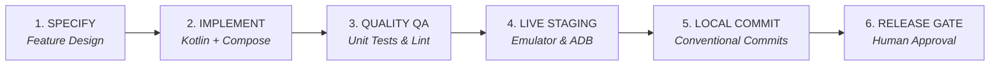

# 🔄 USBAnywhere Android — Engineering Workflow & Quality Standards

> **Standard**: Professional Android Open-Source Engineering  
> **Repository Target**: `https://github.com/oscarlosu-lab/USBAnywhere-Android`  
> **Quality Standard**: 100% Compilation Pass + Automated Unit Tests + Live Staging Validation

---

## 🔁 1. The 6-Stage Engineering Lifecycle



### Stage 1: Specification & Threat Modeling
- Define the feature boundary (Server vs Client vs Subsystem).
- Identify hardware constraints: OTG permissions, non-touch Android TV limitations, thread priority (`THREAD_PRIORITY_URGENT_AUDIO`), power consumption, and network jitter buffers.
- Ensure compliance with the community roadmap (`ROADMAP.md`).

### Stage 2: Implementation & Coding Standards
- **Language**: Kotlin 2.0+ with modern idioms (records, data objects, sealed interfaces).
- **UI Framework**: Jetpack Compose Material 3 with 10-foot UI compliance (D-Pad focusability on all interactive components).
- **Concurrency**: Structured Coroutines (`viewModelScope`, `Dispatchers.IO` for sockets, `Dispatchers.Default` for URB translation).
- **USB Resource Hygiene**:
  - Every `UsbDeviceConnection` must be claimed via `claimInterface(intf, true)` and released in a `finally` block with `releaseInterface(intf)` and `close()`.
  - Every `WakeLock` and `WifiLock` must have explicit lifecycle bindings with try/finally release mechanisms.
- **Error Handling**:
  - **Zero Naked Exceptions**: Prohibit unhandled empty catch blocks. Always log or wrap in structured state (`Result<T>` or `TunnelState.Error`).
  - Sockets must set timeouts (`SO_TIMEOUT`) and `TCP_NODELAY = true` for esports-grade transmission.

### Stage 3: Automated Quality & Testing Gates
Before any code can be committed, it must pass all verification gates:
```powershell
# 1. Run all unit tests
.\gradlew.bat test

# 2. Verify release compilation and lint
.\gradlew.bat assembleRelease
```
- **Gate 1 (AST / Syntax)**: Kotlin and XML parse without syntax errors or missing imports.
- **Gate 2 (Hygiene & Encoding)**: All files must be UTF-8 encoded with standard LF handling.
- **Gate 3 (Security & Privacy)**: Zero hardcoded secrets, private tokens, passwords, or private internal system paths.
- **Gate 4 (Unit & Protocol Tests)**: Full test execution passing with exit code 0 (`.\gradlew.bat test`).

### Stage 4: Live Staging & Emulation Testing
- Test the build on an active emulator or physical device:
  ```powershell
  # Compile APK
  .\gradlew.bat assembleDebug

  # Install on target device
  adb install -r app\build\outputs\apk\debug\app-debug.apk

  # Launch main activity
  adb shell am start -n com.usbanywhere/.MainActivity
  ```
- Validate UI behavior:
  - Take screenshot evidence: `adb exec-out screencap -p > screenshot.png`.
  - Test D-Pad navigation for Android TV: `adb shell input keyevent KEYCODE_DPAD_DOWN` and `KEYCODE_DPAD_CENTER`.
  - Verify background service persistence and notification channels.

### Stage 5: Local Git Staging
- Check working tree status: `git status -s`.
- Stage and commit with descriptive **Conventional Commits**:
  - `feat(...)`: New features (e.g. `feat(gamepad-tv): ...`).
  - `fix(...)`: Bug fixes.
  - `docs(...)`: Documentation updates.
  - `refactor(...)`: Code refactoring without behavior change.
  - `test(...)`: Unit/integration tests.

### Stage 6: Release Gate (Human Authorization)
- Releases and remote pushes to GitHub are governed by explicit human authorization.
- Only when all roadmap milestones for a given version are verified, documented, and explicitly cleared, may changes be published to GitHub.

---

## 🛠️ Verification & Diagnostic Quick Reference

| Command | Purpose |
|---|---|
| `.\gradlew.bat test` | Run all unit tests (protocol, catalog, state machine, tracker) |
| `.\gradlew.bat assembleDebug` | Compile debug APK (`app-debug.apk`) |
| `.\gradlew.bat assembleRelease` | Compile minified release APK (`app-release.apk`) |
| `.\gradlew.bat bundleRelease` | Compile Google Play Store App Bundle (`app-release.aab`) |
| `adb devices` | List active emulators and physical devices |
| `adb logcat -s USBAnywhere:*` | Stream app logs in real time |
| `adb exec-out screencap -p > ` | Capture UI screenshot for visual validation |
